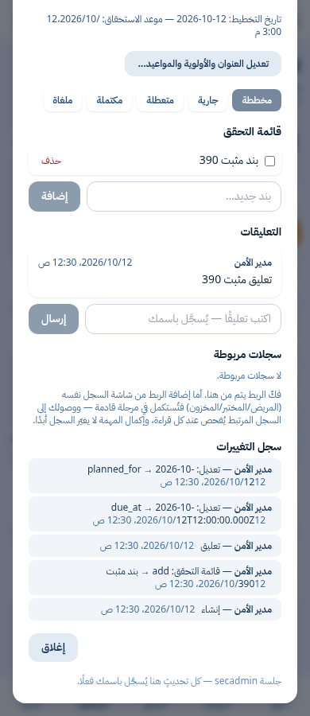
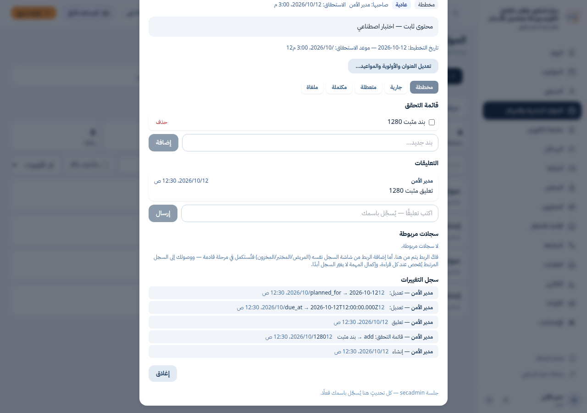

# أدلة إصلاح نافذة المهام —390/1280

هذه أدلة اصطناعية محلية أصلية من PostgreSQL18.6 وChromium، راجعتها قبل النشر؛ لا سجلات مرضى أو موظفين حقيقيين أو مدفوعات حقيقية أو أسرار وصول. أسماء secadmin ومدير الأمن والبنود والتعليقات أسماء fixture. الصورتان PNG أصليتان دون تحرير.

الكود المختبر ثابت عند ae316190fc0e7464b262374b3d3d63c006896f77 فوق f31e0083e161b79577476fd7e962dc3647c2eb45، وشجرته b530c0d33f09c441133b55b0c240675c75350840. إضافة هذه الأدلة فقط لا تغير أي كود أو اختبار. لا تضم R1.

قبل الإصلاح: الاختبار النهائي نفسه نجح3 وفشل1 عند390، بعرض تمرير415px، وزرَي إضافة/إرسال عند يسار−25.39px. after-test.txt: اختبارات العرض/الموعد6 ناجحة؛ regression-test.txt:30 اختبار متصفح قائم؛ unit.txt:24 وحدة. المجموع60 نجاحًا. البناء وtypecheck ناجحان؛ lint بلا أخطاء مع تحذيرين قائمين في الأساس موثقين أيضًا في before-lint.txt. لا إعادة تشغيل لهذه الأدلة عند النشر.

نتائج الإجراءات الفعلية عند390 و1280: إضافة بند200، إرسال تعليق201، حفظ الموعد200، ثم مقارنة صفوف قاعدة البيانات وإعادة الفتح، والإغلاق وEscape والتمرير الداخلي. ملفات after/task-actions-*.json تسجل النتائج؛ MEASUREMENTS.json يجمع القياسات الأصلية للأزرار والنافذة قبل/بعد. القياسات المكانية محفوظة وقت تصوير النافذة، وليست سجلًا مستقلًا لإحداثيات لحظة كل نقرة. اختبار __tests__/security-http/hr-task-modal-width-ui.test.ts:40 في الكود المثبت يتحقق قبل كل نقرة من ظهور كامل مستطيل الزر واستقبال مركزه ومنتصفات حوافه للنقر، ثم ينفذ click عاديًا دون force؛ نجاح الاختبارات يوثّق مرور هذه التأكيدات.

الصورتان: after/task-actions-completed-390.png وafter/task-actions-completed-1280.png. جميع الملفات ومعها بصماتSHA256 في MANIFEST_SHA256.json. layout-only-proof.json يثبت تطابق AST بعد استبعاد className وalignTop فقط.

RECEIPT.json محفوظ كما كان قبل دفع الكود ويذكر pushed=false تاريخيًا؛ PUSH_RECEIPT.json يسجل الدفع اللاحق المصرح به إلى review/hr-task-modal-width-f31. هذه الحزمة لا تحتوي ملفات اتصال أو نتائج Library الداخلية.

## نشر الأدلة للمراجعة

أضيف هذا المجلد في التزام وثائق وأدلة فقط بعد الكود المختبرae316190. محاولة Library واحدة بالمسار المدعوم تعذرت بسبب اتصال الشبكة قبل بدء الرفع، لذلك نُشرت هذه الملفات على فرع المراجعة المصرّح به. لم تُعد الفحوص المكتملة.

نسخ مصادر الإثبات في هذا المجلد محفوظة بلاحقة `.txt` حتى تبقى أدلة نصية ولا تدخل في اكتشاف الاختبارات أو فحص أنواع التطبيق؛ محتواها وبصماتها محفوظان.
