# First implementation checkpoint — patient premium UI

Approved baseline: `175957f4e074d28b819d00a51f3f1e6d53b3d78b`. This checkpoint covers the patient-scoped blue sidebar/app header, compact patient header, operational Summary and Account presentation. It is **not final visual acceptance of all 15 screens**.

The existing Logo, canonical ledger, money writers, role filtering and navigation/draft guards are retained. No schema/API/financial-engine/CI changes. Summary supports selecting each active plan independently; undefined agreement amounts display unavailable rather than zero.

## Actual evidence

All pictures below come from the real built application, PostgreSQL 18 and synthetic patients. No mocked API responses or replacement CSS were used by the capture test. Reference numbers are illustrative and were not copied into the application. The same fixture recipe was used before and after; generated record IDs/time labels differ.

### summary

| Width | Reference (1448px original) | Baseline | Implemented |
|---|---|---|---|
| 1448 | 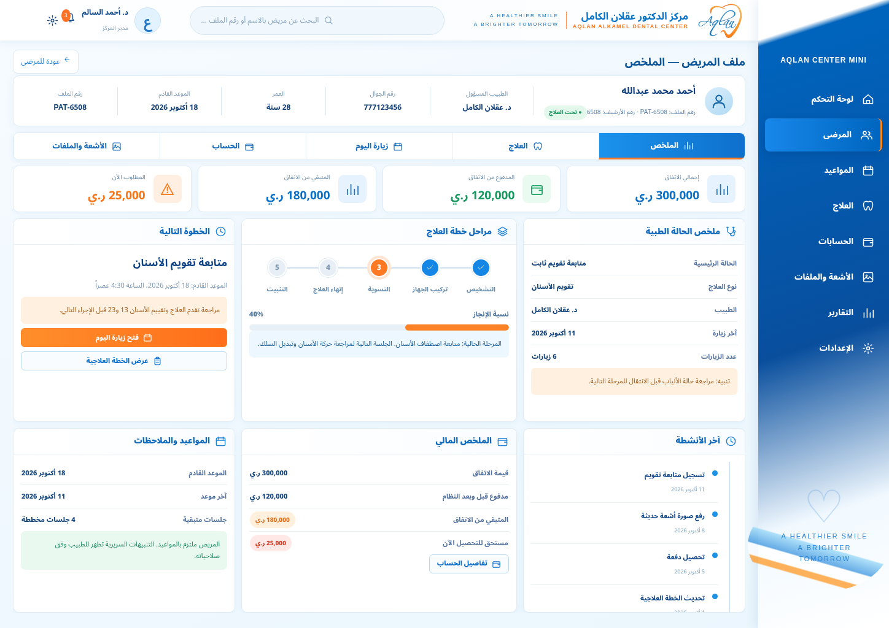 | 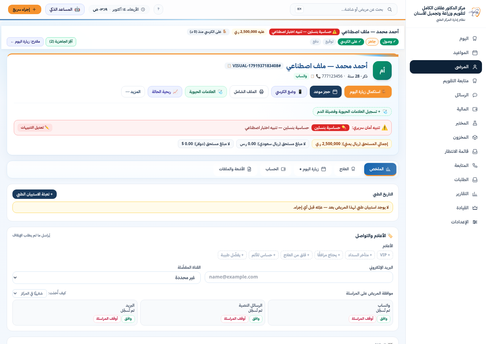 | 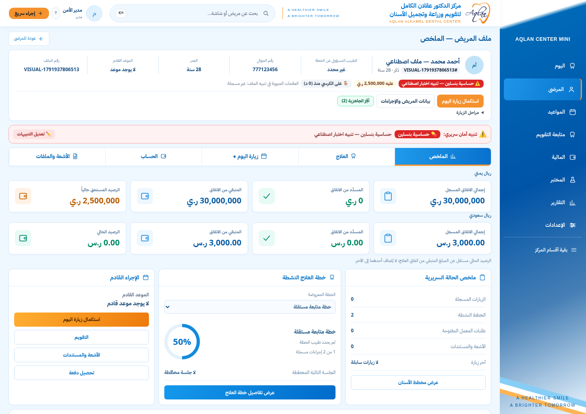 |
| 1280 |  | 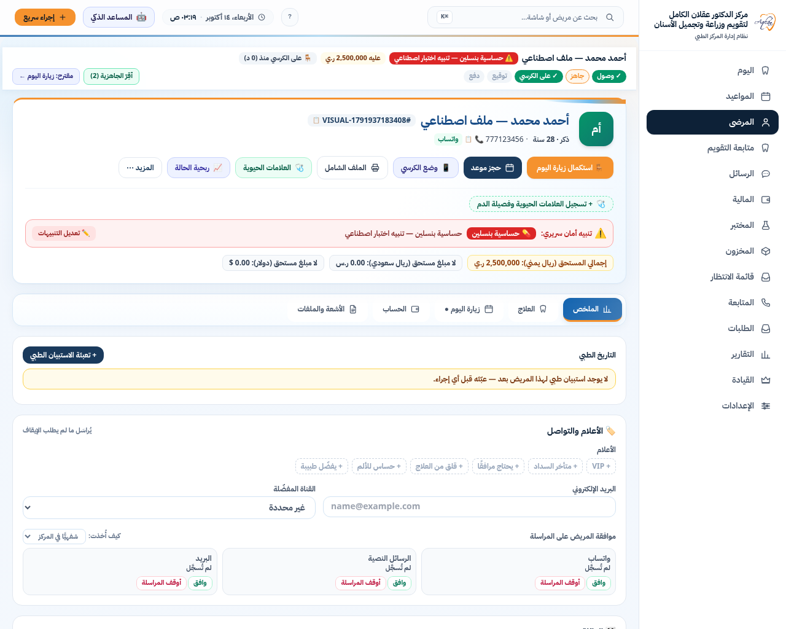 | 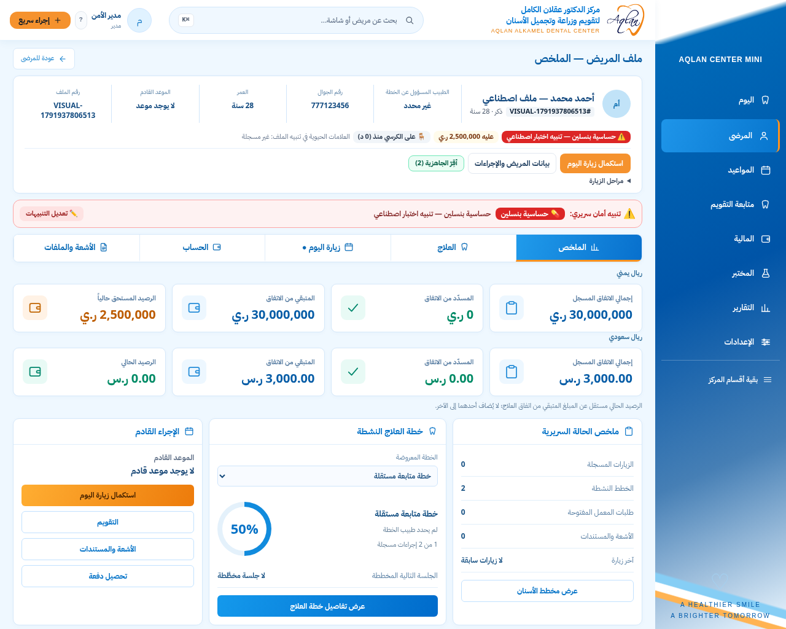 |
| 390 |  | 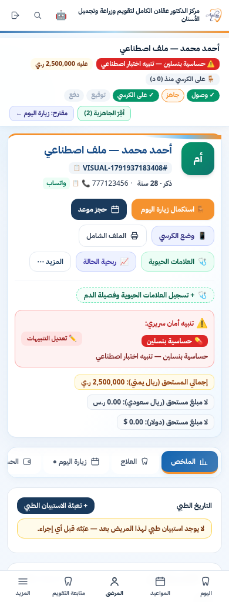 | 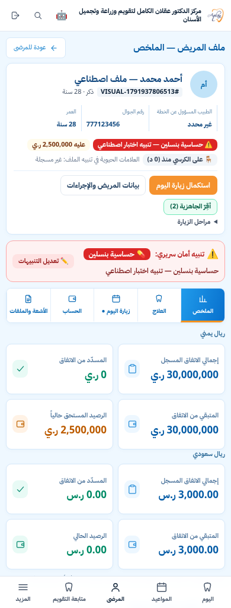 |

### account

| Width | Reference (1448px original) | Baseline | Implemented |
|---|---|---|---|
| 1448 |  | 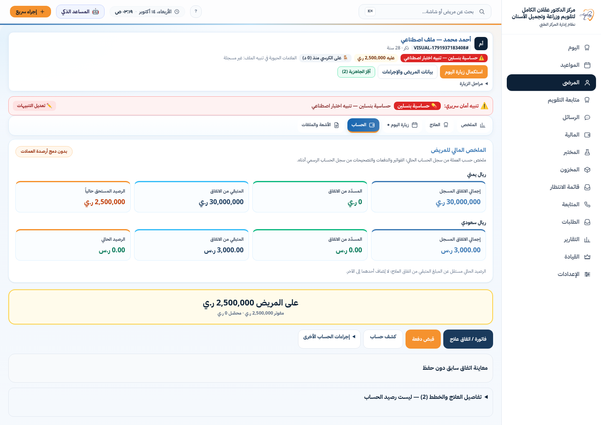 | 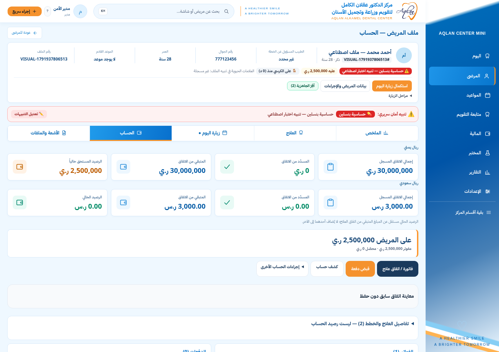 |
| 1280 |  | 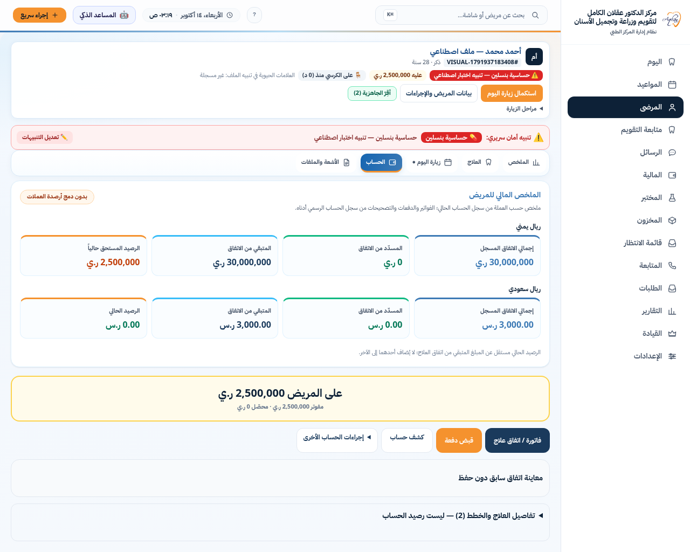 | 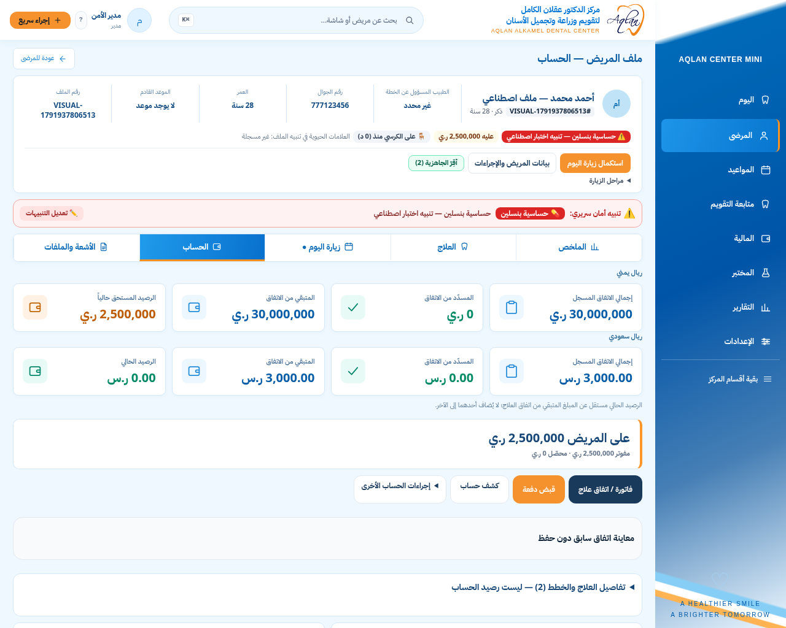 |
| 390 |  | 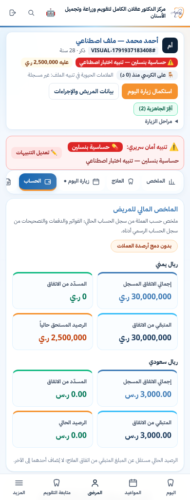 | 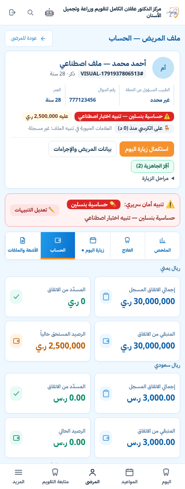 |

## Verification

- Typecheck and optimized production build: passed.
- Full ESLint: 0 errors, 185 warnings (existing warnings remain; no lint rules changed).
- Focused unit suites: 59 passed (patient alert lifecycle, Summary layout, native currency/permission presentation, navigation).
- Built-app browser suites: 42 passed, 2 CI-only evidence cases not run locally (the existing `CI && GITHUB_ACTIONS` condition is unchanged). Suites cover real screenshots at 1448/1280/390, Summary/More dismissal and editable state, clinical navigation, invoice-first creation, duplicate click, preview refusals, delayed acknowledgement, retry and recovery.
- Viewport overflow and JavaScript error assertions passed for all 15 initial captures (five primary screens × three widths).

The first local run exposed two obsolete browser expectations for the primary visit action inside the expanded header. They now assert the visible compact-header action and retain safety/editor/draft checks. One old unit expectation similarly required automatically expanded Summary details; it now requires the consistent compact identity and explicit disclosure.

## Visual review: remaining work

The blue sidebar now has the reference width, gradient, primary navigation hierarchy and decorative footer. The header, five equal tabs, white/blue cards and Summary three-column grouping are implemented. Mobile uses readable stacked content and five compact tabs without horizontal overflow.

The operational header remains taller than the reference because actual chair/readiness controls and complete clinical warnings stay visible. The synthetic account has YER and SAR and therefore two separate metric rows; the reference shows only one currency. Account actions/history must be further composed to approach the reference four-column center region; the original ledger still owns those actions. These are documented gaps, not a claim of pixel-perfect completion. Today Visit, Files and specialty workspaces are the next implementation batch.

Staging was not changed. Direct access is blocked by the environment proxy, and its published SHA has not been independently checked. Work continues locally on the approved baseline. Production/main are untouched.
